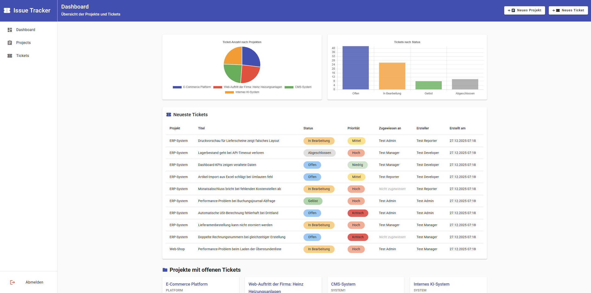
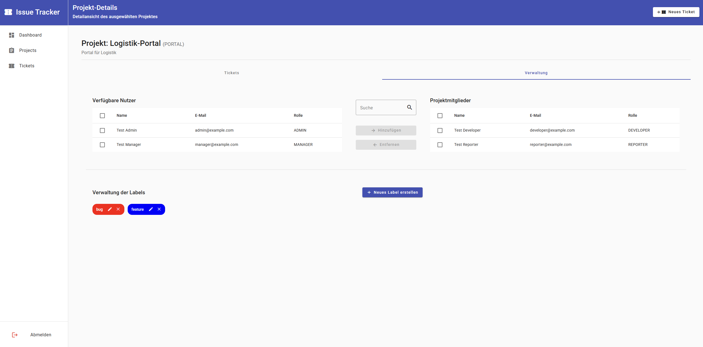

# Issue Tracker

Issue- und Projektverwaltung mit Angular, NestJS, Prisma und PostgreSQL in einem Nx-Monorepo.

## Starten

Voraussetzungen: Node.js 20, npm und Docker Desktop für die lokale Datenbank.
Alle Befehle werden im Hauptverzeichnis ausgeführt.

```sh
npm ci --legacy-peer-deps
```

Die lokale Einrichtung und die verfügbaren Betriebsarten beschreibt der
[Schnellstart](docs/QUICKSTART.md).

## Projektstruktur

```text
apps/
  frontend/             Angular: core, features und shared
  backend/              NestJS-Module, Prisma-Schema und Migrationen
libs/shared-types/      Gemeinsame DTOs, Modelle, Enums und API-Konstanten
config/env/             Environment-Vorlagen
docker/                Gemeinsame Compose-Services und Varianten
scripts/database/       Seed-, Export- und Importwerkzeuge
scripts/                Einrichtung und Deployment
docs/                  Aktuelle Anleitungen und historische Berichte
.github/                Workflows und Community-Dokumente
```

`docker-compose.yml` bleibt der Standard-Einstieg für Docker. Nx-, npm- und
TypeScript-Konfiguration sowie `render.yaml` liegen im Hauptverzeichnis.
Aktive `.env`-Dateien bleiben lokal im Hauptverzeichnis.

## Entwicklung und Prüfung

```sh
npm run dev                 # Frontend und Backend nativ starten
npm run lint                # Alle Projekte linten
npm run build               # Prisma Client und Produktionsbuilds
npm test                    # Vorhandene Deployment-Regressionstests
npm run prisma:studio       # Datenbankbrowser
```

Derzeit gibt es keine allgemeinen Unit- oder E2E-Test-Targets. `npm test` führt
gezielt `backend:deployment-check` aus.

## Deployment

Frontend und Backend laufen als Docker-Webservices auf Render, die Datenbank bei
Prisma Postgres. Releases auf `master` werden durch GitHub Actions geprüft und
über Render-Deploy-Hooks ausgeliefert.

- [Deployment und CI/CD](docs/deployment/README.md)
- [Docker-Konfigurationen](docker/README.md)
- [Environment-Vorlagen](config/env/README.md)
- [Gesamte Dokumentation](docs/README.md)

## Screenshots




## Mitarbeit und Lizenz

[Contributing](.github/CONTRIBUTING.md) ·
[Code of Conduct](.github/CODE_OF_CONDUCT.md) ·
[Security](.github/SECURITY.md) · [Changelog](docs/project/CHANGELOG.md) ·
[MIT-Lizenz](LICENSE)
