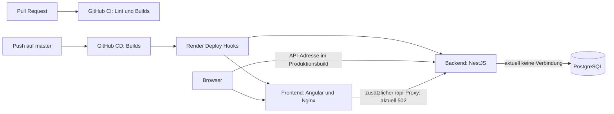

> Historisches Dokument. Maßgeblich sind [Deployment](../../deployment/README.md) und [Schnellstart](../../QUICKSTART.md). Beispiele können veraltet sein.

# Deployment-Überprüfung vom 18. Oktober 2026

Stand der Live-Prüfung: etwa 13:48 Uhr, Europe/Berlin. Geprüfter lokaler Commit: `831fb40` vom 31. Dezember 2025. Welcher Commit tatsächlich auf Render läuft, wurde nicht verifiziert.

**Ergebnis: Das Frontend ist erreichbar, die Anwendung ist wegen einer fehlenden Datenbankverbindung aktuell nicht vollständig betriebsbereit.** Zusätzlich antwortet der API-Proxy des Frontends mit HTTP 502. Die bestehenden Health Checks können diesen Zustand fälschlich als erfolgreiches Deployment bewerten.

Die Prüfung umfasst Repository-Konfiguration, aufgelöste Nx-Projekte, lokale Produktionsbuilds und öffentliche HTTP-Endpunkte. Render-Einstellungen, Secrets, Datenbankzustand im Dashboard, GitHub-Branchschutz und letzte Workflow-Ausführungen wurden nicht eingesehen. Es wurden keine Deployments oder Änderungen an Produktionsdaten ausgelöst.

## Architektur und Deployment-Ablauf

| Bestandteil | Konfiguration im Repository | Einordnung |
| --- | --- | --- |
| Workspace | npm, Nx 22.2.3; Projekte `frontend`, `backend`, `shared-types` | Projektkonfiguration über `nx show project --json` geprüft |
| Frontend | Angular 20, Docker, Nginx, Port 8080 | Öffentliche Domain: `https://issue-tracker.ademdokur.dev` |
| Backend | NestJS 11, Node 20 Alpine, Docker, Port 3000 | API: `https://issue-tracker-backend-23d7.onrender.com/api` |
| Datenbank | PostgreSQL über Prisma 5 | Render-Datenbank vorgesehen; aktuell vom Backend nicht erreichbar |
| Hosting | Render, Region Frankfurt, `plan: free` laut Blueprint | Tatsächlich gebuchte Pläne nicht geprüft |
| Datenbankänderungen | Prisma-Migrationen vorhanden, npm-Skript `prisma:migrate` | Kein automatischer Aufruf im aktiven Deploymentpfad |

CI (`.github/workflows/ci.yml`) läuft bei Pull Requests auf `master` und `feature/**` sowie manuell: Abhängigkeiten installieren, Prisma Client generieren, Linting, Backend- und Frontend-Build.

CD (`.github/workflows/cd.yml`) läuft bei Push auf `master` sowie manuell: Abhängigkeiten installieren, Prisma Client generieren, beide Anwendungen bauen, zwei Render-Hooks aufrufen, 300 Sekunden warten und öffentliche URLs prüfen. Erforderliche GitHub-Secrets: `RENDER_DEPLOY_HOOK_BACKEND` und `RENDER_DEPLOY_HOOK_FRONTEND`. Deren Vorhandensein wurde nicht verifiziert.

Die in GitHub gebauten Artefakte werden nicht an Render übergeben. Render baut die Anwendungen erneut über die Dockerfiles. Eine Bindung des Hook-Aufrufs an den geprüften Commit fehlt. Die Dokumentation beschreibt zusätzlich Render Auto-Deploy bei Commits; ist dies tatsächlich aktiviert, sind parallele oder doppelte Deployments möglich. Die aktuelle Dashboard-Einstellung ist unbekannt.

## Bestätigter Live-Zustand

| Endpunkt | HTTP | Beobachtung |
| --- | --- | --- |
| Frontend `/` | 200 | HTML erreichbar; allein kein Nachweis funktionierender Anmeldung oder Datenzugriffe |
| Frontend `/health` | 200 | Nginx liefert eine feste Antwort ohne Backend-Prüfung |
| Backend `/api/health` | 200 | JSON enthält `status: error` und `database: disconnected`; Prisma meldet einen nicht erreichbaren Datenbankserver |
| Backend `/api/health/ready` | 500 | Backend ist für Datenbankzugriffe nicht bereit |
| Backend `/api/health/live` | 200 | Prozess läuft: `alive: true` |
| Frontend `/api/health` | 502 | Nginx-Fehlerseite; Weiterleitung zum Backend schlägt fehl |

Die Ursache des Datenbankausfalls ist ohne Render-Zugriff offen. Zu prüfen sind Datenbankstatus, aktuelle interne Verbindungsadresse, Region und Backend-Logs. Ein abgelaufener oder entfernter Datenbankdienst ist nur eine mögliche Erklärung. Der Proxyfehler ist separat zu untersuchen: Der direkte Backend-Aufruf liefert eine JSON-Antwort, der Aufruf über Nginx scheitert bereits mit 502.

## Befunde und Prioritäten

| Priorität | Befund und Beleg | Empfohlene Maßnahme |
| --- | --- | --- |
| P0 | Datenbank vom laufenden Backend nicht erreichbar; Health-JSON und Readiness bestätigen den Fehler | Render-Datenbank und `DATABASE_URL` prüfen; Verbindung wiederherstellen und danach Schema/Migrationsstand prüfen |
| P1 | `health.controller.ts` fängt Datenbankfehler ab und gibt ein Objekt zurück, ohne einen Fehlerstatus zu setzen; live HTTP 200 trotz Fehler | Bei fehlender Datenbank HTTP 503 zurückgeben; Readiness für Freigabe des Traffics verwenden; interne Prisma-Fehler nicht öffentlich ausgeben |
| P1 | CD ignoriert fehlgeschlagene Health Checks über erfolgreiche `echo`-Zweige; Hook-Aufrufe verwenden kein `curl --fail` | HTTP-Fehler zum Workflow-Abbruch führen lassen und Backend-Readiness verbindlich prüfen |
| P1 | CD wartet pauschal 300 Sekunden und prüft keinen Render-Deploymentstatus oder Commit | Deployment bis zum Abschluss verfolgen und den tatsächlich ausgelieferten Commit verifizieren |
| P1 | Live-Proxy liefert 502; `nginx.conf` enthält eine feste Backend-Adresse und keine explizite SNI-Aktivierung | Nginx-Upstream-Logs, TLS/SNI und Namensauflösung prüfen; konkrete Ursache vor einer Änderung bestätigen |
| P1 | `render.yaml` definiert PostgreSQL als `type: pserv` unter `services`; `fromDatabase` referenziert jedoch eine Datenbank, die nicht unter `databases` definiert ist | Blueprint gemäß Render-Schema korrigieren und validieren; bestehende Live-Ressourcen vor Anwendung abgleichen |
| P1 | Backend-Dockerfile startet Prisma-Generierung und Node; weder Docker-CMD noch Workflows führen `prisma migrate deploy` aus | Kontrollierten Migrationsschritt vor Traffic-Freigabe ergänzen; `prisma generate` aktualisiert kein Datenbankschema |
| P2 | Am live geprüften HTML fehlen CSP, `X-Frame-Options`, `X-Content-Type-Options`, `Referrer-Policy` und `Permissions-Policy`, obwohl auf Server-Ebene konfiguriert | Header-Vererbung in Nginx korrigieren und HTML sowie Assets erneut prüfen |
| P2 | Angular verwendet eine direkte Backend-URL, während die konfigurierte CSP nur `connect-src 'self'` zulässt | API-Strategie vereinheitlichen: funktionierenden `/api`-Proxy nutzen oder direkte API-Verbindungen ausdrücklich erlauben; aktuell fehlende CSP bedeutet keinen nachgewiesenen Browser-Blocker |
| P2 | `BACKEND_URL`, `CORS_ORIGINS`, `THROTTLE_TTL`, `THROTTLE_LIMIT` und JWT-Laufzeiten werden gesetzt, aber nicht entsprechend ausgewertet | Konfiguration mit der Implementierung verbinden oder irreführende Variablen entfernen |
| P2 | `JWT_EXPIRES_IN=15m` steht im Blueprint, `auth.module.ts` verwendet fest `24h`; separate Refresh-Konfiguration wird im Auth-Flow nicht genutzt | Tatsächliche Token-Laufzeit und gewünschtes Refresh-Verhalten abstimmen |
| P2 | Produktions-CORS erlaubt zusätzlich mehrere localhost-Adressen; keine explizite Proxy-Vertrauenskonfiguration für IP-basiertes Rate Limiting gefunden | Produktions-Origins begrenzen und Client-IP-Ermittlung hinter Render/Nginx prüfen |
| P2 | Keine automatisierten Test-Schritte in CI/CD; keine Test-Targets bei Backend und Frontend vorhanden | Einen fachlichen Smoke-Test für Anmeldung und Datenzugriff ergänzen |
| P2 | CD enthält kein `concurrency`, kein explizites GitHub-Environment und kein Rollback-Verfahren | Gleichzeitige Produktionsdeployments koordinieren und Wiederherstellung dokumentieren |

Render verlangt PostgreSQL-Ressourcen unter `databases`; `pserv` bezeichnet einen privaten Dienst. Zusätzlich ist `env: production` in den Serviceeinträgen problematisch: `env` ist das veraltete Aliasfeld für `runtime`, keine Kennzeichnung einer Produktionsumgebung. Die Web-Dienste setzen bereits `runtime: docker`. Grundlage: [Render Blueprint-Referenz](https://render.com/docs/blueprint-spec). Das ist eine Prüfung gegen die Spezifikation, keine ausgeführte Render-API-Validierung.

Die fehlenden HTML-Security-Header passen zur Nginx-Konfiguration: Eigene `add_header`-Direktiven in den Locations für HTML und Assets verhindern die normale Übernahme der Server-Header. `always` ändert diese Vererbungsregel nicht. Siehe [Nginx Header-Dokumentation](https://nginx.org/en/docs/http/ngx_http_headers_module.html). Ein gemeinsames Header-Include in den relevanten Locations wäre mit dem verwendeten Nginx-1.27-Image vereinbar.

Für den HTTPS-Upstream ist SNI standardmäßig deaktiviert. Das ist ein konkreter Prüfpunkt für den Proxy, aber ohne Nginx-Fehlerlogs keine bestätigte Ursache des 502. Siehe [Nginx HTTPS-Proxy-Dokumentation](https://nginx.org/en/docs/http/ngx_http_proxy_module.html#proxy_ssl_server_name).

## Builds und Betriebsfähigkeit

| Prüfung | Ergebnis |
| --- | --- |
| `npm exec --no -- nx show projects --json` | Erfolgreich: drei Projekte |
| Aufgelöste Nx-Konfiguration für Backend und Frontend | Erfolgreich gelesen |
| `npm exec --no -- nx run backend:build --skipNxCache` | Erfolgreich; Build verwendet `--node-env=production` |
| `npm exec --no -- nx run frontend:build:production --skipNxCache` | Erfolgreich nach Wiederholung außerhalb der Dateisystem-Sandbox |
| Frontend-Buildwarnungen | Initiales Bundle 592,27 kB statt Warnschwelle 500 kB; CommonJS-Abhängigkeiten; veraltete Browserslist-Daten |
| Docker-Images und sauberer `npm ci` | Nicht ausgeführt; lokale Builds nutzen vorhandene Abhängigkeiten und den vorhandenen Prisma Client |
| Fachlicher Ende-zu-Ende-Test | Nicht ausgeführt; keine Anmeldung oder Änderung von Anwendungsdaten |

Der erste Angular-Build scheiterte an Sandbox-Zugriffsrechten; der identische Build war außerhalb der Sandbox erfolgreich. Daraus ergibt sich kein bestätigter Projekt-Buildfehler. Erfolgreiche lokale Builds beweisen weder den Linux-Docker-Build noch die Funktionsfähigkeit des live deployten Standes.

Die Dockerfiles verwenden mehrere Build-Stufen und nicht privilegierte Laufzeitbenutzer. Das Backend generiert den Prisma Client allerdings bei jedem Start neu und installiert zur Laufzeit die Produktionsabhängigkeiten des gesamten Workspace. Das Frontend baut eine feste API-Adresse ein; die gesetzte Variable `BACKEND_URL` ersetzt diese nicht.

`docker-compose.yml` nutzt ebenfalls den Produktionsbuild mit externer Render-API-Adresse und bildet deshalb keinen unabhängigen lokalen Stack ab. `docker/docker-compose.full.yml` verwendet dagegen einen Development-Frontend-Build mit `localhost:3000`. Beide Varianten enthalten öffentlich bekannte Ersatzwerte für Passwörter und JWT-Secrets; ihre Verwendung auf Produktion wurde nicht geprüft.

Vorhandene Deployment-Dokumente stammen überwiegend aus Dezember 2025. Aussagen wie „Production Ready“, automatisch ausgeführte Migrationen, verfügbare Swagger-Dokumentation in Produktion und vollständig wirksame Security-Header stimmen nicht mit allen geprüften Implementierungen bzw. Live-Ergebnissen überein. Swagger ist im Backend-Code für Produktion ausdrücklich deaktiviert.

## Reihenfolge für die Wiederherstellung

1. Datenbankstatus und aktuelle interne `DATABASE_URL` im Render-Dashboard prüfen; Verbindung wiederherstellen. Anschließend muss Readiness erfolgreich antworten und der Schema-/Migrationsstand passen.
2. Den separaten Proxyfehler anhand der Nginx-Logs eingrenzen. Danach eine einheitliche API-Adresse für Angular, Proxy und CSP festlegen.
3. Health-Endpunkte und CD so korrigieren, dass Datenbankausfälle und fehlgeschlagene Deployments einen Fehlerstatus erzeugen.
4. Blueprint und Migrationsablauf reparieren; Commit-Zuordnung und mögliche doppelte Deployment-Auslöser klären.
5. Security-Header, Token-Konfiguration und fachlichen Smoke-Test nachziehen; bestehende Betriebsdokumentation aktualisieren.

Noch im Hostingkonto zu verifizieren: aktive Dienste und Pläne, persistenter Datenbankbetrieb, Backups mit erfolgreicher Wiederherstellungsprobe, Secrets, Branchschutz, Auto-Deploy-Einstellung, letzter deployter Commit und Alarmierung. Dazu liefert das Repository allein keinen belastbaren Nachweis.
